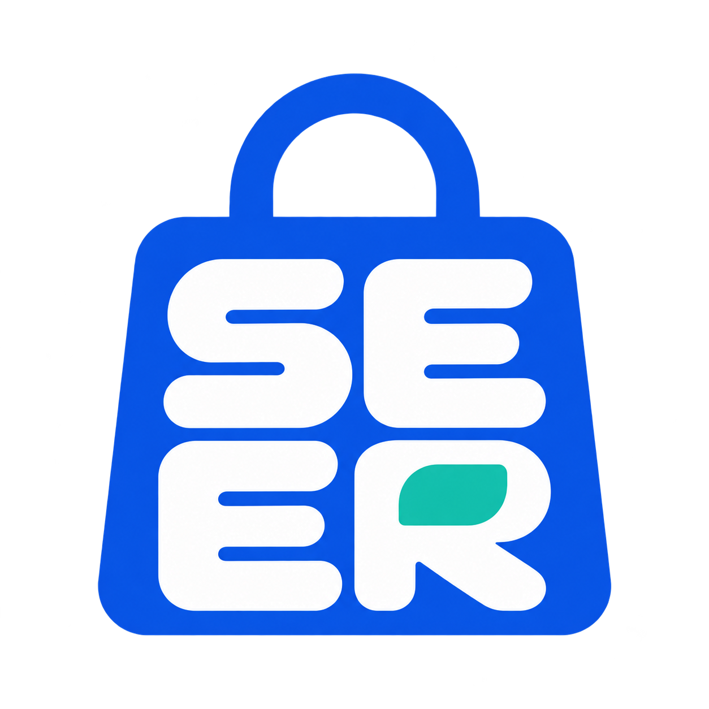
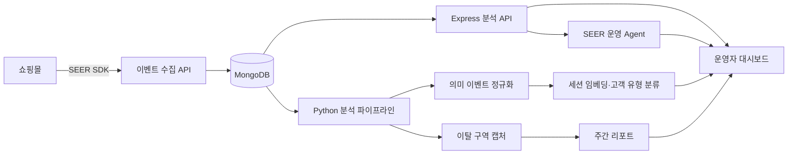
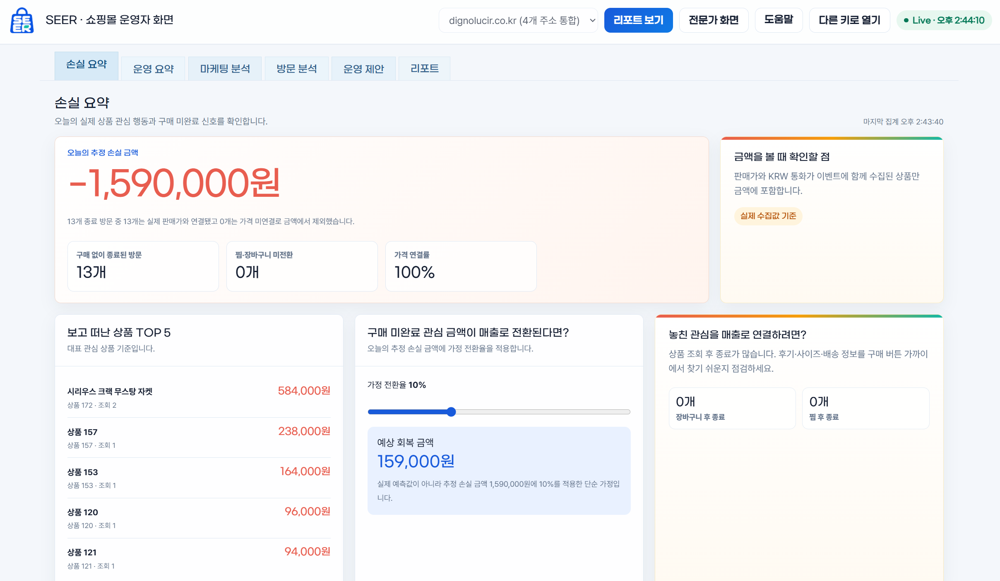
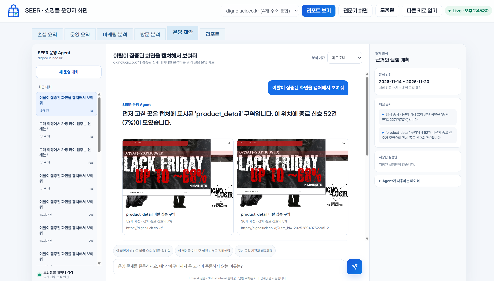
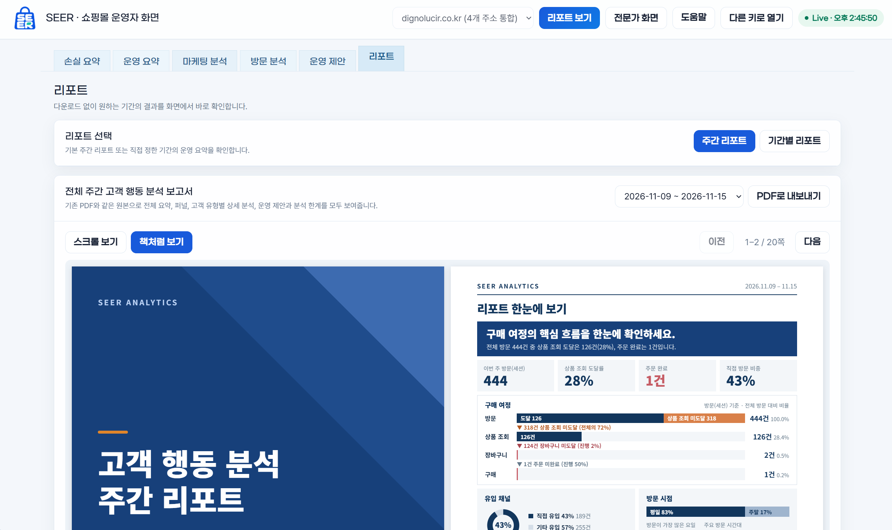

<div align="center">
  <a href="https://capstone-toridos.duckdns.org/">
    
  </a>

  <h1>SEER</h1>
  <p><strong>고객의 망설임을 발견하고, 오늘의 운영 액션으로 바꾸는 쇼핑몰 운영 도우미</strong></p>
  <p>SDK 한 줄로 고객 행동을 수집하고, 전환 손실·방문 흐름·고객 유형을 분석해<br />쇼핑몰 운영자가 바로 실행할 수 있는 제안과 리포트를 제공합니다.</p>

  <p>
    <a href="https://capstone-toridos.duckdns.org/"><strong>서비스 바로가기</strong></a>
    &nbsp;·&nbsp;
    <a href="https://capstone-toridos.duckdns.org/guide.html?view=code24"><strong>SDK 설치 가이드</strong></a>
    &nbsp;·&nbsp;
    <a href="https://app.notion.com/p/Toridos-GhostTracker-265f0c1d63f280a0a66cd0457f8280f7?source=copy_link"><strong>팀 Notion</strong></a>
  </p>

  <p>
    
    
    
    
  </p>
</div>

---

## SEER는 무엇을 해결하나요?

일반적인 분석 도구는 수많은 지표를 보여주지만, 작은 쇼핑몰 운영자에게는 **무엇을 먼저 고쳐야 하는지**가 더 중요합니다. SEER는 방문부터 구매까지의 행동을 세션 단위로 연결하고, 고객이 멈춘 화면과 행동 신호를 이해하기 쉬운 운영 언어로 바꿉니다.

| Observe | Understand | Act |
| :---: | :---: | :---: |
| 클릭·스크롤·상품 탐색·구매 흐름 수집 | 퍼널 이탈·고객 유형·종료 신호 분석 | 우선순위·실행안·7일 뒤 확인 지표 제안 |

## 핵심 기능

- **자동 행동 수집** — 쇼핑몰 공통 레이아웃에 SDK를 한 번 설치하면 방문, 클릭, 스크롤, 상품 조회, 장바구니, 찜, 주문 행동을 수집합니다.
- **구매 여정 분석** — 방문 → 상품 조회 → 장바구니 → 결제 → 구매 흐름과 단계별 중단율을 계산합니다.
- **고객 유형 분류** — 행동 시퀀스를 의미 토큰으로 정규화하고, 세션 임베딩과 군집화를 통해 반복되는 고객 패턴을 찾습니다.
- **이탈 화면 확인** — 종료 신호가 집중된 URL과 화면 구역을 찾아 실제 페이지 캡처 위에 표시합니다.
- **SEER 운영 Agent** — 저장된 집계 데이터만을 근거로 개선 우선순위, 확인할 가능성, 오늘 바꿀 것과 검증 지표를 제안합니다.
- **기간별 리포트** — 하루·주간·한 달·직접 지정 기간의 핵심 관찰과 운영 액션을 제공하며, 주간 PDF 리포트를 생성합니다.

## 서비스 구조



1. 브라우저 SDK가 쇼핑몰 행동을 감지하고 세션·페이지·유입 정보를 함께 전송합니다.
2. Express 수집 API가 이벤트를 검증해 MongoDB에 저장하고, 사이트 키로 쇼핑몰 데이터를 분리합니다.
3. Python 파이프라인이 원시 이벤트를 의미 토큰으로 변환하고 고객 유형과 이탈 집중 지점을 분석합니다.
4. 대시보드와 운영 Agent가 분석 결과를 운영자가 이해할 수 있는 지표와 실행안으로 제공합니다.
5. 리포트 생성기가 퍼널, 유입, 고객 유형, 이탈 화면과 개선안을 주간 PDF로 구성합니다.

## 프로젝트 구조

```text
SEER/
├── index.js                     # 브라우저 SDK 진입점
├── sdk-A.js / sdk-B.js / sdk-C.js
│                                # 초기화·행동 감지 모듈
├── core/
│   ├── sessionManager.js        # 세션 생명주기
│   ├── eventProcessor.js        # 공통 필드와 파생 데이터
│   ├── platformAdapter.js       # 쇼핑몰 플랫폼 적응 계층
│   └── sender.js                # 이벤트 전송 큐
├── backend/
│   ├── public/
│   │   ├── gt.js                # 배포용 SDK 번들
│   │   ├── operator-dashboard.html
│   │   └── guide.html           # 공개 SDK 설치 가이드
│   ├── routes/                  # 수집·로그·분류·리포트·Agent API
│   ├── services/                # 운영 분석·Agent·리포트 스케줄러
│   ├── models/                  # Event·SiteKey·Report·AgentThread
│   └── server.js                # Express 서버
├── ml/
│   ├── semantic_event_mapper.py # 원시 이벤트 → 의미 토큰
│   ├── cluster_server.py        # 실시간 고객 유형 분류 API
│   ├── retrain_centroids.py     # 사이트별 군집 재학습
│   ├── exit_capture.py          # 이탈 집중 구역 캡처
│   ├── agent_visual_capture.py  # Agent용 화면 근거 수집
│   └── report_exact_template.py # 주간 리포트 생성
├── tests/                       # SDK·수집 흐름 검증
└── docs/                        # 설치·배포·아키텍처 문서
```

## 운영자 대시보드

하나의 화면에서 **문제 발견 → 원인 탐색 → 실행안 확인 → 결과 리포트**까지 이어집니다.

| 메뉴 | 제공 정보 |
| --- | --- |
| **손실 요약** | 구매로 이어지지 않은 관심 행동과 상품별 추정 기회 금액 |
| **운영 요약** | 탐색 중지 신호, 막히는 화면, 주요 원인과 실행 우선순위 |
| **마케팅 분석** | 상품 행동, 유입 경로, 고객 유형별 성과와 캠페인 단서 |
| **방문 분석** | 최근 고객의 세션 타임라인과 선택 고객의 상세 행동 흐름 |
| **운영 제안** | 실제 집계 근거를 사용한 대화형 운영 Agent와 저장 가능한 실행안 |
| **리포트** | 기간별 요약, 주간 고객 행동 분석 보고서와 PDF 내보내기 |

### 손실과 운영 현황을 한눈에



### 근거를 확인하며 대화하는 운영 Agent



### 웹에서 확인하고 PDF로 내보내는 주간 리포트



## SDK 설치

가장 정확한 최신 설치 절차는 **[SEER SDK 설치 가이드](https://capstone-toridos.duckdns.org/guide.html?view=code24)**에서 확인할 수 있습니다.

쇼핑몰 공통 레이아웃의 `</body>` 바로 위에 발급받은 사이트 키와 함께 SDK를 추가합니다.

```html
<script
  src="https://capstone-toridos.duckdns.org/gt.js"
  data-site-key="발급받은_사이트_키"
  defer
></script>
```

상품과 구매 관련 요소에 `data-gt-*` 속성을 지정하면 상품명·가격·행동 의미를 더 정확하게 연결할 수 있습니다.

```html
<button
  data-gt-action="add_to_cart"
  data-gt-product-id="P-1001"
  data-gt-product-name="시그니처 후드"
  data-gt-price="59000"
>
  장바구니 담기
</button>
```

## 로컬 실행

### 1. 백엔드와 Python 의존성 설치

```bash
cd backend
npm install

cd ../ml
python -m pip install -r requirements.txt
```

### 2. 환경 변수 설정

`backend/.env.example`을 복사해 `backend/.env`를 만들고 MongoDB, 사이트 키, 분석 서버 주소를 설정합니다.

```dotenv
MONGODB_URI=mongodb://127.0.0.1:27017/seer
PORT=3000
ALLOWED_ORIGINS=http://localhost:3000
SITE_KEYS=demo-site-key
CLUSTER_SERVER_URL=http://127.0.0.1:5002
PREDICT_SERVER_URL=http://127.0.0.1:5002
GEMINI_API_KEY=
```

### 3. 분석 서비스와 웹 서버 실행

```bash
python ml/cluster_server.py --port 5002
```

```bash
cd backend
npm start
```

- 서버 상태: `http://localhost:3000/health`
- 운영자 화면: `http://localhost:3000/operator-dashboard.html?key=<사이트키>`
- 사이트 키 관리: `http://localhost:3000/admin-keys.html`

## 디그노루시르와의 협업

SEER는 패션 쇼핑몰 **[디그노루시르](https://dignolucir.co.kr/)**와 협업해 실제 이커머스 운영 환경에서 데이터 수집과 분석 흐름을 검증했습니다.

- Cafe24 공통 레이아웃에 SDK를 적용해 실제 방문 행동 수집
- 상품 조회·리뷰·찜·장바구니·구매 여정의 의미 이벤트 검증
- 운영자가 해석하기 쉬운 고객 유형과 탐색 중지 지표 설계
- 이탈 집중 화면 캡처와 주간 운영 리포트를 실제 페이지 기준으로 검토

이 협업을 통해 단순 로그 수집을 넘어, **현장에서 바로 확인하고 실행할 수 있는 운영 도구**를 만드는 데 집중했습니다.

## 관련 문서

- [SEER 메인 페이지](https://capstone-toridos.duckdns.org/)
- [SDK 설치 가이드](https://capstone-toridos.duckdns.org/guide.html?view=code24)
- [팀 Notion](https://app.notion.com/p/Toridos-GhostTracker-265f0c1d63f280a0a66cd0457f8280f7?source=copy_link)
- [현장 설치 가이드](docs/onsite-install-guide.md)
- [현재 아키텍처](docs/notion-current-architecture.md)
- [배포 체크리스트](docs/deploy-checklist.md)
- [Python 분석 서비스 배포](docs/python-service-deploy.md)

## Team Toridos

<table>
  <tr>
    <td align="center"><a href="https://github.com/kdm0927"><strong>김다민</strong></a></td>
    <td align="center"><a href="https://github.com/joehyun000"><strong>박조현</strong></a></td>
    <td align="center"><a href="https://github.com/suyeonb"><strong>배수연</strong></a></td>
  </tr>
  <tr>
    <td align="center"><a href="https://github.com/kdm0927">@kdm0927</a></td>
    <td align="center"><a href="https://github.com/joehyun000">@joehyun000</a></td>
    <td align="center"><a href="https://github.com/suyeonb">@suyeonb</a></td>
  </tr>
</table>

---

<div align="center">
  <strong>SEER</strong><br />
  고객의 망설임을 운영 기회로 바꿉니다.
</div>
